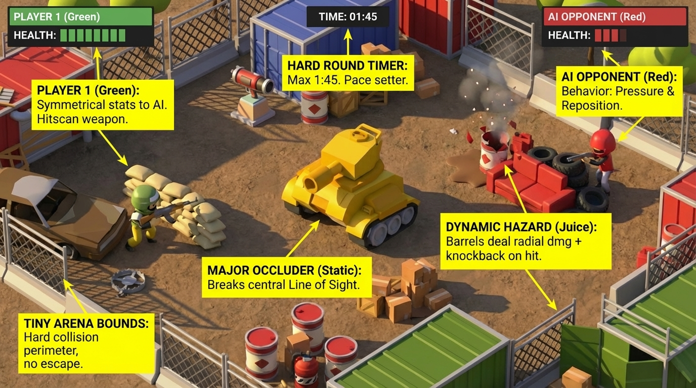

# Tiny Toon Duel (Three.js)

A quick-action toon shooter built with Three.js and Vite. Duel 1v1 or 4-player deathmatch against AI, playable in the browser.

<p align="center">
  
</p>

## Project Layout

```
index.html                  # Landing page
toonshooter/index.html      # Game page (markup only)
src/
├─ main.js                  # Game script (being split into modules)
└─ styles.css               # Game styles
public/
├─ assets.json              # Asset manifest (loaded by the game)
├─ assets/                  # GLTF models / textures referenced by the manifest
└─ toonshooter/             # Static images for the landing page
vite.config.js              # Multi-page build (landing + game)
vercel.json                 # Vercel build/output config (clean URLs, caching)
```

## Running Locally

```bash
npm install
npm run dev      # http://localhost:5173/ (landing) and /toonshooter/ (game)
npm run build    # outputs to dist/
npm test         # unit tests (Vitest)
```

## Deployment (Vercel)

Framework preset: **Vite**. Build command `npm run build`, output directory `dist` (declared in `vercel.json`). Clean URLs are enabled, so `/toonshooter` and `/toonshooter/` both work. Files under `/assets` are cached with `Cache-Control: public,max-age=31536000,immutable`.

## Asset Management

- `public/assets.json` is the single source of truth for model paths. The game fetches it at runtime and resolves URLs relative to the game page.
- When adding or pruning models, update the manifest so the scene and assets stay aligned.

## Local Dev Notes

- Optional Three.js workflow references live in `.claude/skills/threejs-builder/` (not deployed).
